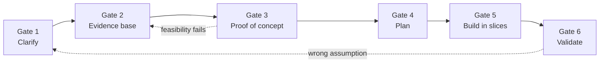

# Project Approach — Sagittarius RAG

| Field | Value |
|-------|-------|
| Document type | Approach and rationale for the project owner |
| Project | Sagittarius RAG (RAG over the Mag knowledge base) |
| Version | 0.2 (Draft) |
| Status | For review |
| Author | Nathan Tran |
| Audience | Project owner / approver |
| Last updated | TODO |
| Related documents | [Clarify](Clarify/Clarify.md) (not yet approved) |

**Evidence labels used in this document**

| Label | Meaning |
|-------|---------|
| **Fact** | Stated in Clarify or observable in the repo |
| **Assumption** | We believe it, nobody has verified it |
| **Unknown** | We do not know; the owner of the answer is named |
| **Reasoning** | A conclusion derived from the above; it is only as strong as its premises |

---

## 1. What this document asks of you

1. Agree that we **start by reducing uncertainty**, not by building.
2. Agree on the **gates** (section 5): what we deliver at each step and what evidence lets us move on.
3. Answer the **blocking questions** (section 9).

We are **not** asking you to approve a technology, a schedule or a budget. We cannot give honest numbers for those yet, and section 3
explains why.

---

## 2. The situation

| # | Statement | Label | Source |
|---|-----------|-------|--------|
| S1 | The Mag KB is a set of AI-generated `.md` files | Fact | Clarify §1.1 |
| S2 | The KB is not verified by humans | Fact | Clarify §1.2 |
| S3 | The KB was not written with RAG in mind; structure, size and consistency are uncontrolled | Fact | Clarify §1.2 |
| S4 | The KB is not updated regularly, so nobody can tell how current a file is | Assumption (Clarify: "TODO confirm with examples") | Clarify §1.2 |
| S5 | The team has no RAG or LLM experience | Fact | Clarify §1.2 |
| S6 | RAG is an approved decision (Hai) | Fact | Clarify §2.1 |
| S7 | The KB will become very large soon | Assumption (current size and growth: TODO) | Clarify §2.1, A6 |
| S8 | Whether KB content may go to an external LLM / embedding API | **Unknown** — ask security / management | Clarify §5.1 |
| S9 | Who verifies the KB, who owns it, who operates the tool after v1 | **Unknown** — owner decision | Clarify G1–G4 |
| S10 | Whether any technology is mandated; interface; deadline; budget | **Unknown** — ask the project owner | Clarify §5.1 |

Reading this table: several facts are good news for no one (S2, S3, S5), and the most expensive decisions (S8, S9, S10) depend on
answers that no amount of coding can produce.

---

## 3. Why not simply build it? Three ways to start

| | Learn everything first | Build immediately | **Reduce uncertainty first (chosen)** |
|---|---|---|---|
| Idea | Study RAG fully, then design | Pick a stack, wire a demo, iterate | Find the questions that can change the biggest decisions, answer those cheaply, then plan |
| Time to first visible result | Slow | Fastest (a demo in days) | Medium (a measured proof of concept) |
| Main failure mode | Tutorial hell: lots of reading, nothing verifiable | A confident demo on a stack that later proves unusable (e.g. privacy forbids the cloud LLM), or a demo that hides poor answer quality | Over-analysis, if gates are not time-boxed |
| Fits when | Technology is the only unknown | Problem is clear, stack is mandated, cost of rework is low | **Problem, technology and constraints are all partly unknown** |
| Fits Sagittarius? | No: S5 holds, but learning is not the only unknown | **Not yet**: S8, S9, S10 are unresolved | **Yes** |

### 3.1 The strongest objection, and the answer

> "A RAG demo takes days. Why not build it and see?"

Three answers:

1. **We do build a small end-to-end slice.** The chosen approach includes a proof of concept (section 5, Gate 3). The difference is that the
   slice is designed to answer named questions and is judged against a test set. It is not a demo to show off.
2. **Code cannot answer the three most expensive questions.** Whether KB content may leave the organization (S8), who verifies the KB (S9) and
   what the project owner requires (S10) are answered by people. If we build first, we choose an LLM, embedding model and hosting on a guess about S8.
   A wrong guess invalidates the stack choice, not just a few lines.
3. **A demo on an unverified KB proves little.** With S2 and S3, a demo will look good on easy questions and say nothing about whether answers are *correct*.
   Without a test set (section 6) we cannot tell a good demo from a good system.

The risk of our own approach is over-analysis. We control it with a time-box and an exit criterion on every gate (section 5) and by keeping
the proof of concept small.

---

## 4. The argument, step by step

Each step names the premises it rests on. If a premise is wrong, the conclusion must be revisited. That is intended: this section is
the part you should challenge.

| Step | Claim | Rests on | Strength |
|------|-------|----------|----------|
| P1 | The root requirement is that members get **correct, current** answers and that the knowledge **stays** correct and current. The request "build a RAG tool" is one solution to it | Clarify §2.1 | Reasoning |
| P2 | A RAG answers from retrieved text. Its answers cannot be more correct than the text it retrieves | How RAG works (Lewis et al., 2020; see references) | Well established |
| P3 | The KB is unverified (S2), unstructured by design (S3) and possibly stale (S4) | Facts and one assumption | Mixed |
| C1 | **Therefore RAG alone will return wrong or outdated answers, and citations will make them look trustworthy.** The solution is RAG **plus** a way to keep the KB good (deliverables D2–D4) | P1, P2, P3 | Strong if S4 is confirmed with real examples (**TODO: 2–3 examples from the actual KB**) |
| P4 | The team has no RAG experience (S5), so effort and risk cannot be estimated reliably | Fact | Strong |
| C2 | **Therefore any schedule or estimate given now would be a guess.** Estimates should follow evidence from a small proof of concept | P4 | Reasoning |
| P5 | The stack depends on S8; the scope depends on S9 and S10 | Unknowns | Strong |
| C3 | **Therefore we must not choose the technology yet, and we must get the S8, S9, S10 answers early**, because they cost the most if discovered late | P5 | Reasoning |
| P6 | We cannot judge quality by feel: a RAG fails quietly (fluent wrong answers) | Common failure of LLM systems | Reasoning |
| C4 | **Therefore quality is defined before building**: a test set, a baseline on the KB as it is, and every later change judged against them | P6 | Reasoning |
| P7 | We do not know whether the KB needs work at all. It may already be good enough for retrieval | Unknown | Strong |
| C5 | **Therefore the baseline (KB as is) comes first.** Any KB improvement (template, AI restructuring, smarter indexing) must beat it to justify its cost | P7, C4 | Reasoning |

What the argument does **not** claim: that this is the only reasonable approach, or that RAG is the wrong choice (S6 is accepted).

---

## 5. Methodology

### 5.1 Four working methods, each used where it fits

| Method | What it is | Used here for |
|--------|------------|---------------|
| Top-down | Goal → structure → details | Clarify; the shape of the system |
| Bottom-up | Understand one component by trying it | Chunking, retrieval and prompt behaviour on a few real files |
| Spike | A time-boxed experiment answering one question | The proof of concept (Gate 3) |
| Incremental | Small, verifiable slices; feedback; adjust | Implementation after planning |

### 5.2 Three kinds of uncertainty, three remedies

| Uncertainty | Question | Remedy | Gate |
|-------------|----------|--------|------|
| Problem | What must be solved and what is "done"? | Ask stakeholders, write acceptance criteria | 1 |
| Technical | Which solution fits? | Compare options, run small experiments | 2, 3 |
| Execution | In what order, with what dependencies? | Milestones, dependency map | 4 |

### 5.3 Gates

| Gate | Deliverable | Exit criterion (evidence required) | Proposed time-box* |
|------|-------------|------------------------------------|--------------------|
| 1. Clarify | Approved charter | Owner approves; every high-impact open question has a named answerer | TODO |
| 2. Evidence base | Test set of at least 20 real questions (some unanswerable, some needing several files); inspection of the real KB (size, language, structure, duplicates, secrets); answers to S8–S10 requested | Test set reviewed by someone who knows the Mag project; KB facts recorded | TODO |
| 3. Proof of concept | A thin end-to-end slice on a sample of the KB, run on the test set: **baseline first**, then one or two candidate KB approaches | Results recorded; decisions written in `Docs/Decisions/`; go / change direction / stop | 1–2 days of build, plus analysis |
| 4. Plan | Milestones, dependencies, estimate based on Gate 3 evidence | Owner accepts plan and estimate | TODO |
| 5. Build | Vertical slices (question in, cited answer out), then features | Each slice runs and is measured on the test set | Per plan |
| 6. Validate | Results against the acceptance criteria | Criteria in Clarify §6 met, or gap reported | Per plan |

\* Time-boxes are proposals to be agreed with the owner. Only the proof-of-concept duration comes from earlier drafts; the rest is **TODO**.

**Gates are not strictly sequential.** Gate 2's question requests and the test set can be worked on in parallel with Gate 1 approval.
Work that depends on an unanswered question is parked, not guessed.

### 5.4 Stop and change-direction rules

| Situation | Action |
|-----------|--------|
| A spike exceeds its time-box | Stop, record what was learned, decide with the information available |
| Baseline already meets the target | Do not build KB tooling beyond what the test set justifies |
| A candidate approach does not beat the baseline | Drop it; record the result |
| Evidence shows an earlier assumption was wrong | Return to the earlier gate and say so in the next report |

---

## 6. How quality is judged

| Element | Rule |
|---------|------|
| Test set | At least 20 questions from real use, including unanswerable ones. Kept in `eval/questions.md` |
| Baseline | First run on the KB as is, with no template or rewriting |
| One change at a time | Chunking, retrieval, prompt and KB changes are compared individually, so cause and effect are visible |
| Retrieval before generation | If the right chunk is not retrieved, prompt changes cannot fix the answer; measure retrieval first |
| Metrics | Retrieval hit rate, answer correctness (manual grade), citation correctness, "I don't know" on unanswerable questions, latency, cost per question, edit-to-searchable time |
| Targets | **TODO**: placeholders in Clarify §6 (e.g. ≥ 80% correct with the right source) until the owner confirms |

Limit of this method: the test set is small and manually graded. It detects large differences, not small ones. We will say so when reporting results.

---

## 7. Risks and contingencies

Priority is **impact if wrong × how unsure we are**, not what is easiest to check. This is a pragmatic ranking, not a formal risk model.

| Risk | Impact | Uncertainty | How we reduce it | If it comes true |
|------|--------|-------------|------------------|------------------|
| KB content may not leave the organization (S8) | High | High | Ask security / management now | Local embedding model and LLM: higher setup and hardware cost, possibly lower quality. Must be sized before Gate 4 |
| Nobody verifies the KB (S9) | High | High | Owner decision; answers flag unverified content | RAG still runs, but every answer carries an "unverified" caveat; trust target in Clarify §6 cannot be met |
| KB is poor input for RAG | High | High | Baseline vs candidate approaches on the test set | Choose the cheapest approach that beats baseline; report the gap if none does |
| Team cannot deliver without RAG experience | High | High | Time-boxed learning tied to project questions; small spike | Reduce scope, or request support; reported early |
| Technology is mandated late by the owner | Medium | High | Ask in Gate 1 | Re-evaluate affected choices |
| Daily re-index is not fresh enough | Medium | Medium | Measure edit-to-searchable time | Move to update-on-merge |
| Choice of vector store or framework | Low | High | Defer; pick the simplest that works | Replace; low cost at small scale |

Low-impact choices are deliberately left undecided so that attention goes to the high-impact ones.

---

## 8. Principles and limits

| Principle | Consequence in this project |
|-----------|-----------------------------|
| Understand before optimizing | Problem and constraints before stack |
| Investigate before assuming | Every statement carries an evidence label |
| Test the riskiest assumption first | Section 7 sets the order |
| Deliver evidence, not activity | Progress is reported against the test set and gates |
| Communicate uncertainty early | Unknowns have named answerers; blockers are reported with options and a recommendation |
| Smallest end-to-end first | No reranker, framework or extra service without a measured reason |
| Privacy first | No KB content goes to an external service until approved |

**What would change our mind.** The approach is wrong for this project if any of these turns out to be true:

- The owner confirms a mandated stack and cloud use is approved (S8, S10 resolved early): the process can shorten and the proof of concept can move straight into a first slice.
- The KB is small and stable (S7 false): whole-KB prompting may be viable, and RAG's value should be re-examined with the owner. This would reopen S6, which is the owner's decision, not ours.
- Real KB examples show it is accurate and current (S4 false): C1 weakens, and D2–D4 shrink.

**Limits.** This process suits new technology, many unknowns and a high cost of being wrong. For small, clear tasks it is skipped.
The design here is untested on this team, and the proposed time-boxes are not yet agreed.

---

## 9. What we need from you

Ordered by impact. The first three block real progress.

| # | Need | Blocks |
|---|------|--------|
| 1 | Can KB content go to an external LLM / embedding API, or must everything run locally? (security / management) | LLM, embedding, hosting |
| 2 | What does the MAG project require: users, interface, deadline, budget? | Scope; planning |
| 3 | Who verifies the AI-generated KB, and what does "verified" mean? | Trust in answers |
| 4 | Is any technology mandated? Fixed or negotiable? | Component choices |
| 5 | Current KB size, growth, location, languages, confidential content | Gate 2 and 3 |
| 6 | Who owns the KB and who operates and pays for the tool after v1? | Handover |
| 7 | Do we only define the KB method, or also apply it to the existing KB? Proposal: apply to a small sample as proof | D2 scope |
| 8 | Approve the charter and agree the gate time-boxes and acceptance targets | Gate 1 |

---

## 10. References

External:

- Lewis et al., *Retrieval-Augmented Generation for Knowledge-Intensive NLP Tasks*, 2020. The original RAG formulation: generation conditioned on retrieved passages.
- Extreme Programming literature: the "spike" as a time-boxed technical investigation.
- Hunt and Thomas, *The Pragmatic Programmer*: "tracer bullets", a thin end-to-end slice used to validate architecture. Same idea as our vertical slice.

Internal:

- Author's working note on approaching new projects (source of the three-uncertainties model, impact × uncertainty prioritization and the gate structure). Not a published source.

TODO: verify the exact citations above before this document is circulated.
