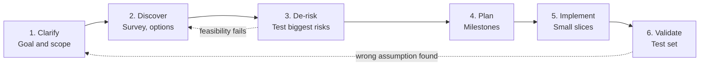

# Project Approach — Sagittarius RAG

| Field | Value |
|-------|-------|
| Document type | Approach briefing for the project owner |
| Project | Sagittarius RAG (RAG over the Mag knowledge base) |
| Version | 0.1 (Draft) |
| Status | For review |
| Author | Nathan Tran |
| Audience | Project owner / approver (non-implementer) |
| Last updated | TODO |
| Related documents | [Clarify](Clarify/Clarify.md) · [Discover](Discover/Discover.md) |

---

## 1. Summary

We are **not starting by building a RAG tool**. We are starting by reducing uncertainty, in this order:

1. **Identify the right problem** — what the project must achieve, not which tool to use.
2. **Reduce uncertainty** — find out what we do not know, and test the riskiest assumptions first.
3. **Find a feasible path to finish** — plan only after the evidence exists.

The reason: the team has no RAG experience, the knowledge base (KB) is AI-generated and unverified, and several
high-impact facts are still unknown (for example whether KB content may be sent to a cloud LLM). Building first would
mean choosing a stack on guesses and finding the wrong guess late, when it is expensive to fix.

**What we need from you** is in [section 7](#7-decisions-and-information-we-need-from-you).

---

## 2. The idea: manage uncertainty, not just write code

In a project with many unknowns, the work is making good decisions with incomplete information. We separate three kinds of
uncertainty, because each needs a different remedy:

| Uncertainty | Meaning | How we reduce it | Where it is handled |
|-------------|---------|------------------|---------------------|
| Problem | What exactly must be solved, and what is "done"? | Ask stakeholders, write acceptance criteria | [Clarify](Clarify/Clarify.md) |
| Technical | Which solution fits? | Survey options, run small experiments | [Discover](Discover/Discover.md) |
| Execution | In what order, with what dependencies? | Milestones, dependency map | Plan phase (later) |

Learning a framework before the problem is clear risks making the team expert in something the project does not need.

---

## 3. The process

It is not a one-way line. If evidence shows an assumption was wrong, we go back and say so.

| Step | Output | Status |
|------|--------|--------|
| 1. Clarify | Charter: objective, scope, constraints, acceptance criteria, open questions | In progress — waiting for owner answers |
| 2. Discover | Option comparison, test set, decision log | In progress |
| 3. De-risk | Proof of concept (1–2 days) that answers the riskiest questions | Not started |
| 4. Plan | Milestones, schedule, estimate | Not started — deliberately after step 3 |
| 5. Implement | Working end-to-end slices | Not started |
| 6. Validate | Results against acceptance criteria | Not started |

**Approval requested now is only to proceed to Discover, not to build.** (Clarify §8.)

---

## 4. What we have already concluded (and why it matters)

### 4.1 RAG alone is not enough

The stated request is "build a RAG tool over the `.md` files". The root requirement is that project members get
**correct, current** answers, and that the knowledge **stays** correct and current.

The KB is unverified, was not written with RAG in mind, and is not updated regularly. A RAG over it would return **wrong answers
faster, with citations that make them look trustworthy.** So the scope is RAG **plus** a way to manage the KB
(Clarify §2.1). RAG itself is an approved decision (Hai), and we do not reopen it. Because the KB is expected to grow very
large, retrieval is required rather than putting the whole KB into a prompt.

### 4.2 Five deliverables

| ID | Deliverable | Why |
|----|-------------|-----|
| D1 | RAG tool (ask in chat/UI, get answer + source, or "I don't know") | The visible product |
| D2 | A method to make the current and future KB good input for RAG | Quality is capped by the KB |
| D3 | Index freshness (the index reflects the latest KB) | Stale answers erode trust |
| D4 | Update workflow (how members change the KB) | KB stays current only if updating is easy |
| D5 | Documentation | Also records what the team learns |

D2 delivers a **method**, not KB content. The KB stays owned by its authors.

---

## 5. How we reduce risk

### 5.1 Learn what the project needs, not everything about RAG

Each learning topic is tied to a project question and has a time-box (Discover §5.5). Topics that exceed the time-box are
decided with the information available, and the gap is recorded.

### 5.2 Test the riskiest assumptions first

Priority is **impact if wrong × how unsure we are**, not what is easiest to check.

| Risk / assumption | Impact if wrong | Uncertainty | How we verify |
|-------------------|-----------------|-------------|---------------|
| KB content may go to an external LLM / embedding API | High — decides the whole stack | High (**Unknown**) | **Ask security / management** (no experiment can answer this) |
| The KB can be made good input for RAG with acceptable effort | High | High | Baseline vs candidate approaches on the test set |
| A small team with no RAG experience can deliver in the available time | High | High | Proof of concept; time-boxed learning |
| Who verifies the AI-generated KB | High | High | Owner decision (G1, G4) |
| Daily re-index is good enough | Medium | Medium | Measure edit-to-searchable time |
| Which vector store / framework | Low–Medium | High | Defer; choose the simplest that works |

Low-impact choices (vector store, framework) are deliberately **not** decided early.

### 5.3 Proof of concept before commitment

A time-boxed slice (1–2 days, Discover §7): about 10 `.md` files in, five real questions asked, one unanswerable question,
answers with source links, and a re-index that touches only changed files.
It has a clear question, a clear stop condition, and is allowed to fail: a failed spike that rules out a bad direction early is a good
result.

### 5.4 Measure, do not feel

We write a test set of at least 20 real questions (some unanswerable, some needing several files) **before** building.
Every claim about quality, and every change to chunking, retrieval or prompts, is judged against it.

**The baseline comes first.** We run the test set on the KB *as is* (no template, no rewriting). Any approach to improve the KB, such as the
authoring template, AI restructuring or smarter indexing, must **beat that baseline** to justify its cost. If the baseline
is good enough, we do less work.

---

## 6. Principles we follow

| Principle | In this project |
|-----------|-----------------|
| Understand before optimizing | Clarify before Discover; problem before stack |
| Investigate before assuming | Facts, assumptions and verified items are separated (Clarify §5.2) |
| Test the riskiest assumption first | Section 5.2 |
| Deliver evidence, not activity | Progress is measured against the test set and acceptance criteria |
| Communicate uncertainty early | Open questions have owners; unknowns are written as `Unknown — need to ask <who>` |
| Smallest end-to-end first | Simplest working version, then improve; no reranker, framework or extra service without a measured reason |
| No silent technology choices | Every choice with alternatives goes into the Decision Log |
| Privacy first | No KB content goes to an external service until approved |
| AI-generated KB is unverified | Answers cite sources, flag unverified or conflicting content, and may say "I don't know". Only a human sets `verified` |

### What we will not do

- Pick a language, vector store, LLM or embedding model before the evidence and the privacy answer exist.
- Plan dates and estimates before the proof of concept reduces the unknowns. Any date given now would be a guess.
- Treat the KB template as the answer. It is one candidate (A1), to be measured against the baseline.

---

## 7. Decisions and information we need from you

Ordered by impact. The first three block real progress.

| # | Need | Why it matters | Blocks |
|---|------|----------------|--------|
| 1 | Can KB content be sent to an external LLM / embedding API, or must everything run locally / on-premise? (ask security / management) | Decides the LLM, embedding model and hosting | Choice of LLM and embedding |
| 2 | What does the MAG project require: users, interface (web, Slack, Teams, …), deadline? | Defines scope and success | Interface; planning |
| 3 | Who verifies the AI-generated KB, and what does "verified" mean? (G1, G4) | The RAG cannot be more correct than the KB | Trust in answers |
| 4 | Is any technology mandated (framework, LLM, vector store, cloud, language)? Is it fixed or negotiable? | Avoids designing something that cannot be used | Component choices |
| 5 | Current KB size and expected growth; where the files live; languages; any confidential content | Sizes the vector store and update job | PoC sample; index design |
| 6 | Who owns the KB and operates and pays for the tool after v1? (G2, G3) | Long-term sustainability | Handover |
| 7 | Do we only define the KB method, or also apply it to the existing KB? (G5) Proposal: apply it to a small sample as proof | Prevents scope creep | D2 scope |
| 8 | Approve moving from Clarify to Discover; confirm acceptance targets (e.g. ≥ 80% correct with right source, latency, freshness) | Targets are placeholders now | Clarify §6 |

---

## 8. What you can expect to see next

| Next | What you get |
|------|--------------|
| Short term | Answers to the open questions; test set of at least 20 questions; baseline result on the KB as is |
| After the proof of concept | Findings, decision records in `Docs/Decisions/`, and a recommendation for the KB approach, the stack and the index update approach |
| Then | A Plan with milestones: feasibility, one vertical slice (question in, cited answer out), full features, then hardening and delivery |

We will report early if a risk threatens the schedule. A report states the finding, its impact, the evidence, the options and a
recommendation, and says what decision we need from you.

---

## 9. Caveat

This process fits a project with new technology, many unknowns and a high cost of being wrong. It is deliberately
lightweight for small, clear tasks: a small, reproducible bug goes straight to fixing and testing.
