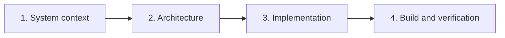
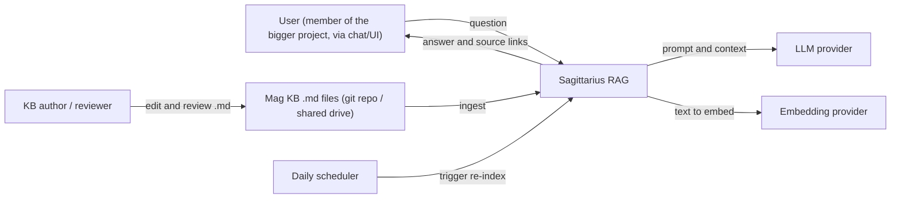
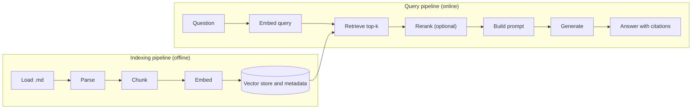

# Discover — Sagittarius RAG

| Field | Value |
|-------|-------|
| Document type | Project Discovery |
| Project | Sagittarius RAG (RAG over the Mag knowledge base, for a bigger project) |
| Version | 0.1 (Draft) |
| Status | In progress |
| Author | Nathan Tran |
| Reviewers | TODO |
| Last updated | TODO |
| Related documents | [Clarify.md](../Clarify/Clarify.md) |

**Revision history**

| Version | Date | Author | Description |
|---------|------|--------|-------------|
| 0.1 | TODO | Nathan Tran | Initial draft |

---

## 1. Purpose

This document records what must be understood about the system before technical decisions are made. It follows the Clarify step, which defined the problem, users, scope and success criteria.

The guiding question is not "how long will it take to learn this framework?" but:

> Which parts of the system must be understood in order to make the right technical decisions?

The aim is to learn a technology in order to solve a problem, not to study it for its own sake.

**Starting point.** The team has no prior experience with RAG, LLM integration or vector search. The knowledge base (KB) is AI-generated and not yet verified. The outcomes wanted (see Clarify §2.2 and §3) are a RAG capability, a KB that is good input for RAG, and an index that stays current with the KB. How to reach the last two is **not decided**. Discover therefore covers three areas: **how RAG works**, **what makes a KB good input for RAG and which approach to use (section 4.4)**, and **how the index is kept up to date**.

## 2. Approach

The system is surveyed in four layers, moving from the general to the specific:

| Layer | Question | Section |
|-------|----------|---------|
| 1. System context | Where does the system live? | 3 |
| 2. Architecture | How is it organized? | 4 |
| 3. Implementation | How does it work in detail? | 5 |
| 4. Build and verification | How do we know it works correctly? | 6 |

**Conventions.** Every `TODO` must be completed. If an answer is not available, record `Unknown — need to ask <who>`. Decisions are recorded in the Decision Log (section 8).

---

## 3. System Context

### 3.1 Objective

Identify the system boundary: the users, data sources and external services it interacts with.

### 3.2 Context diagram

### 3.3 Context questions

| Question | Answer |
|----------|--------|
| Who asks questions? (see Clarify §1.3) | Members of the bigger project (humans). TODO: confirm |
| Who writes and verifies the KB? | TODO |
| What is the "bigger project" and what does it need? | TODO |
| Through which interface (web UI, Slack, Teams, CLI)? | TODO |
| Where are the documents stored (repository URL or drive path)? | TODO |
| How do documents enter the system? | Current idea: scheduled daily re-index (not decided, see section 4.4). TODO: where the job runs |
| Which external services are called (LLM, embedding)? | TODO |
| Where does the system run (local, on-premise, cloud)? | TODO |
| Which data must not leave the organization? Can KB content go to a cloud LLM / embedding API? | **Unknown — need to ask security / management (blocks the choice of LLM)** |
| Who owns and maintains the system after v1? | TODO |

**Deliverable:** a context diagram in which every connection is labelled with the data it carries.

---

## 4. Architecture

### 4.1 Objective

Identify the building blocks of a RAG system and select an option for each.

### 4.2 Reference architecture

### 4.3 Component options

| Component | Options to evaluate | Knowledge required | Decision |
|-----------|--------------------|--------------------|----------|
| Loader | Local clone, git API, drive API | Detecting changed files | TODO |
| Parser | Plain text; Markdown-aware (headings, code blocks, tables, front-matter) | Using document structure to guide chunking | TODO |
| Chunking | Fixed size, by heading, by paragraph, with overlap | Chunk size versus answer quality | TODO |
| Embedding model | Hosted API, local model | Cost, language support, vector dimension | TODO |
| Vector store | In-memory, Chroma, FAISS, SQLite-vec, pgvector, Qdrant | Scale, persistence, metadata filtering | TODO |
| Retrieval | Vector only, keyword (BM25), hybrid | When keyword search outperforms semantic search | TODO |
| Reranker | None, cross-encoder, LLM-based | Whether it is needed for v1 | TODO |
| LLM | Hosted API, local model | Cost, privacy, context window | TODO |
| Prompting | Answer only from context, cite sources | Enforcing "I don't know" | TODO |
| Interface | Web UI, chat bot (Slack / Teams), CLI | Users and frequency of use | TODO |
| Index update job | Cron / CI scheduled workflow / server task | Incremental update by content hash; failure alerts | TODO |
| Making the KB good for RAG | See section 4.4 (template, AI restructuring, indexing-time processing, hybrid, baseline) | Which approach beats the baseline | TODO |
| Verification of AI-generated KB | Human review via pull request, status/owner/last-verified fields | What "verified" means; who reviews | TODO |
| Framework | None, LlamaIndex, LangChain, Haystack | Whether a framework is justified | TODO |

### 4.4 Approaches to make the KB good input for RAG and keep it current

Clarify states these as outcomes, not solutions. This section compares candidate approaches; the winner is recorded in the Decision Log (section 8.1) after evidence from the proof of concept.

**Outcome A — KB is good input for RAG and easy to maintain**

| Approach | Idea | Pros | Cons / risks | Evidence needed |
|----------|------|------|--------------|-----------------|
| A1. Authoring template and rules (+ automatic check) | Authors follow a fixed structure and metadata | Cheap at retrieval time; predictable chunks | Authors must follow rules; old AI-generated files must be converted; may be too strict | Do structured files retrieve better on the test set? |
| A2. AI-assisted restructuring | An LLM rewrites or splits existing files into retrieval-friendly units | Handles the existing KB without manual work | Cost; risk of changing meaning; needs human review | Quality and meaning preserved on a sample |
| A3. Processing at indexing time | Chunking and metadata are derived automatically (heading-aware chunking, generated summaries or titles per chunk), KB files stay as they are | Authors write freely; no new rules | More complex indexer; quality depends on source structure | Hit rate on unstructured files vs structured |
| A4. Hybrid | Light rules for authors plus smart indexing | Balanced | More moving parts | Measure A1 and A3 first |
| A5. Other / do nothing | Index files as they are | Zero effort; gives a baseline | May be good enough, or may be poor | Baseline run on the test set |

Always measure **A5 first** as the baseline; every other approach must beat it on the test set to be justified.

**Outcome B — Index reflects the latest KB**

| Approach | Idea | Pros | Cons / risks |
|----------|------|------|--------------|
| B1. Scheduled rebuild (e.g. daily) | Job re-indexes on a timer | Simple; matches the current idea | Up to one period of staleness |
| B2. Update on every merge/commit | CI triggers an incremental update | Near real-time | Needs CI integration |
| B3. On-demand | A person or a button triggers it | Simplest | Easy to forget |

**Outcome C — Members can easily update the KB:** compare "edit `.md` in git with review" against alternatives (wiki, form, chat-based capture) only if the git workflow proves too hard for the authors.

**Design principle.** Version 1 uses the simplest option for each component. Additional techniques (hybrid retrieval, reranking) are introduced only when the evaluation in section 6 shows a specific failure that they correct.

---

## 5. Implementation

### 5.1 Objective

Understand the details that determine answer quality, limited to what the architecture decisions require.

### 5.2 Knowledge source assessment

To be completed after inspecting the actual documents.

| Item | Finding |
|------|---------|
| Number of `.md` files and total size | TODO |
| Average and maximum file length | TODO |
| Language(s) | TODO |
| Typical structure (headings, tables, code, images, diagrams, links) | TODO |
| Available metadata (title, owner, date, tags) | TODO |
| Duplicated or conflicting documents | TODO |
| Method to detect outdated documents | TODO |
| Confidential content found | TODO |

### 5.2.1 KB template and rules

This section is only relevant if approach A1 or A4 (section 4.4) is chosen. The template is designed together with the chunking strategy, because document structure determines chunk quality. Starting hypotheses to test in the proof of concept:

| Rule | Reason |
|------|--------|
| One topic per file; one idea per section | Chunks stay coherent |
| Clear heading hierarchy (H1 title, H2/H3 sections) | Heading-based chunking and precise citations |
| Required front-matter: `title`, `owner`, `status` (draft / verified), `last_verified`, `tags` | Freshness, trust, filtering |
| Target section length (e.g. 150–500 words) | Fits chunk size |
| Self-contained sections (avoid "see above", state the subject) | A chunk is read without its neighbours |
| Stable file names and heading anchors | Stable source links |
| No secrets, keys or internal IPs | Privacy |
| Tables and code blocks kept small and labelled | Not split across chunks |

An automatic check (lint) verifies these rules in CI. Open points: which rules are mandatory vs recommended, and how to treat existing AI-generated files that do not comply (TODO).

### 5.2.2 Daily index update

| Aspect | Question |
|--------|----------|
| Trigger | Current idea: scheduled daily (see options B1–B3 in section 4.4; where does it run?) |
| Change detection | Hash each file; re-embed only changed files; remove chunks of deleted files |
| Failure handling | Retry, keep the previous index, alert someone |
| Visibility | A log or status page showing last run, files changed, errors |
| Consistency | Query must not see a half-built index (build, then switch) |
| Cost | Embedding cost per run when the KB grows |

### 5.3 Chunk metadata

Each chunk stores the following fields to support citations and filtering.

| Field | Example | Purpose |
|-------|---------|---------|
| `source_path` | `docs/firmware/build.md` | Link to the source file |
| `heading_path` | `Build > Flash > Windows` | Point to the exact section |
| `chunk_id` | `build.md#3` | Debugging, de-duplication |
| `last_modified` | `2026-09-30` | Freshness, warning on old content |
| `doc_title`, `tags` | `Firmware build` | Filtering, reranking |

### 5.4 Technical questions to resolve

1. What chunk size and overlap are used, and why? (Test at least two or three settings.)
2. How are code blocks and tables kept intact within a chunk?
3. How are changed files re-indexed incrementally?
4. How many chunks (top-k) are placed in the prompt, and does this fit the context window?
5. How does the prompt enforce citations and a refusal when context is missing?
6. Is conversation history supported in v1, or is each query independent?
7. How are failures handled (LLM unavailable, empty retrieval, rate limits)?

### 5.5 Learning plan

| Topic | Rationale | Depth | Resource | Time-box |
|-------|-----------|-------|----------|----------|
| How RAG works end to end | Team has no RAG experience | Concept, then build a tiny version | TODO | TODO |
| LLM integration (API call, prompt, context window, tokens) | Needed to generate answers | Hands-on with one provider | TODO | TODO |
| Embeddings and similarity | Core of retrieval | Concept and one hands-on model | TODO | TODO |
| Chunking strategies | Largest effect on quality | Compare two or three | TODO | TODO |
| Selected vector store | Storage and query | Basic operations | TODO | TODO |
| Grounded prompt design | Reduce hallucination | Write and iterate | TODO | TODO |
| RAG evaluation | Demonstrate correctness | Small test harness | TODO | TODO |

If a topic exceeds its time-box, decide with the information available and record the gap in section 8.2.

---

## 6. Build and Verification

### 6.1 Objective

Define how correctness is measured before building. This section implements the acceptance criteria in Clarify §6.

### 6.2 Test set

Questions are taken from Clarify §1.3. The set should contain at least 20 questions, including some that are unanswerable and some that require several files.

| # | Question | Expected answer | Expected source (file and section) | Type |
|---|----------|-----------------|------------------------------------|------|
| 1 | TODO: How do I build and flash the firmware for Mag? | TODO | TODO | Factual |
| 2 | TODO | TODO | TODO | How-to |
| 3 | TODO | Not in documents | None | Unanswerable |

### 6.3 Metrics

| Stage | Metric | Method | Target |
|-------|--------|--------|--------|
| Retrieval | Hit rate at k (correct chunk in top-k) | Compare against expected source | TODO |
| Generation | Answer correctness | Manual grade 0 / 1 / 2 | TODO |
| Grounding | Citation points to correct file and section | Manual check | TODO |
| Safety | Responds "I don't know" when not in documents | Unanswerable questions | TODO |
| Performance | Latency per question | Timer | TODO |
| Cost | Tokens or cost per question | Provider usage data | TODO |
| KB quality | Retrieval hit rate by approach (baseline vs chosen); share of files verified | Test set, review status | TODO |
| Freshness | Time from merged edit to searchable | Compare commit time and index run | TODO |

Retrieval is evaluated first: if the correct chunk is not retrieved, prompt changes cannot correct the answer.

### 6.4 Build and run

| Item | Answer |
|------|--------|
| Language and version | TODO |
| Dependency management | TODO |
| Configuration and secrets (kept out of version control) | TODO |
| Run indexing | TODO |
| Run a query | TODO |
| Run the evaluation | TODO |
| Project layout | TODO |
| Automated checks / CI | TODO |

---

## 7. Proof of Concept

Before committing to the full design, a thin end-to-end slice is built (target duration: 1–2 days).

**Checklist**

- [ ] Ingest a sample of documents
- [ ] Retrieve top-k results for five real questions
- [ ] Generate an answer with source links
- [ ] Test one unanswerable question
- [ ] Run the test questions on the KB **as is** (baseline, approach A5)
- [ ] Try one or two approaches from section 4.4 (e.g. draft template on two files, heading-aware chunking) and compare with the baseline
- [ ] Run the index update twice and confirm only changed files are re-embedded
- [ ] Record what worked, what failed, and unexpected findings
- [ ] Update the decisions in section 4.3 based on the results

---

## 8. Outputs

### 8.1 Decision Log

| ID | Date | Decision | Options considered | Rationale | Revisit when |
|----|------|----------|--------------------|-----------|--------------|
| D1 | TODO | TODO: e.g. chunk by heading, max 500 tokens | Fixed size; by heading | TODO | Retrieval below target |
| D2 | | | | | |

### 8.2 Open Questions

| Question | Impact | Owner | Due | Status |
|----------|--------|-------|-----|--------|
| Can document content be sent to an external LLM / embedding API? | High | TODO | TODO | Open |
| Who verifies the AI-generated KB, and how is "verified" defined? | High | TODO | TODO | Open |
| What does the bigger project require (users, interface, deadline)? | High | TODO | TODO | Open |
| What are the current KB size and the expected growth? (RAG is approved by Hai and the KB is expected to become very large, so whole-KB prompting is not planned; the numbers size the vector store and the index update) | Medium | TODO | TODO | Open |
| In which language(s) are the documents written? | Medium | TODO | TODO | Open |

### 8.3 Exit Criteria

The Discover step is complete when:

- [ ] The context diagram is drawn and reviewed (section 3)
- [ ] An option with rationale is chosen for each component (section 4.3)
- [ ] The real documents are inspected and section 5.2 is complete
- [ ] An approach for "KB good for RAG" is chosen from section 4.4 with evidence against the baseline
- [ ] The approach for keeping the index current is decided (sections 4.4 and 5.2.2)
- [ ] A test set of at least 20 questions is written (section 6.2)
- [ ] The proof of concept is complete and its results recorded (section 7)
- [ ] Every high-impact open question has an owner
- [ ] The team is ready to write the Plan / Design document for v1

## 9. Approval

| Name | Role | Decision | Date |
|------|------|----------|------|
| Nathan Tran | TODO | TODO | TODO |
| TODO | | | |
